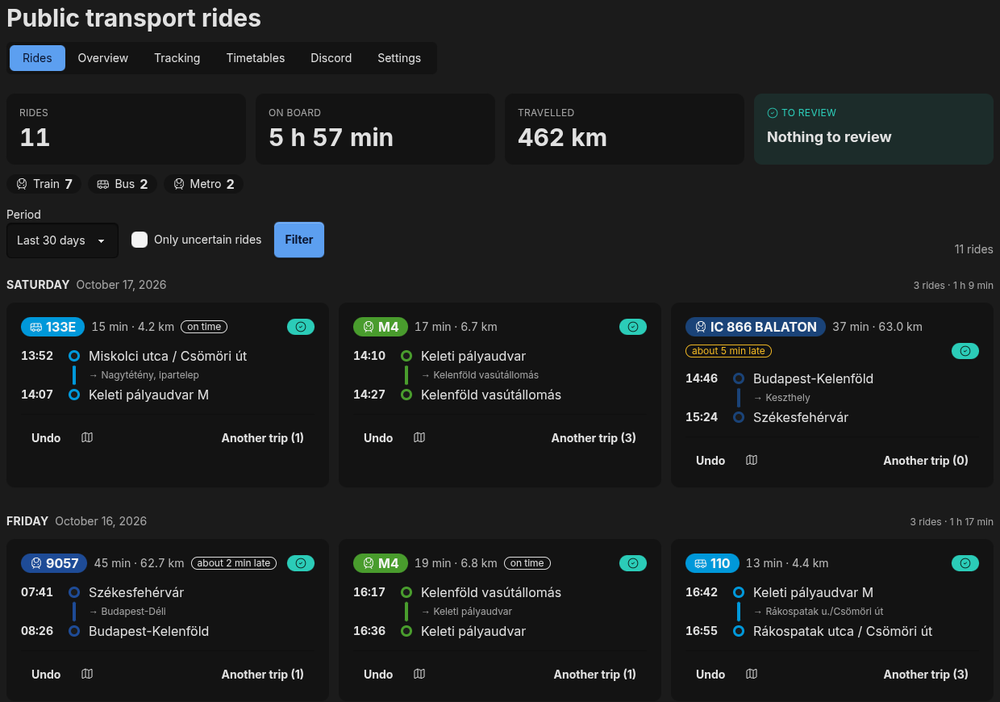
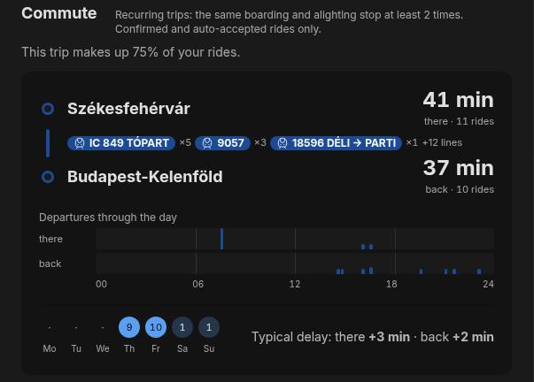
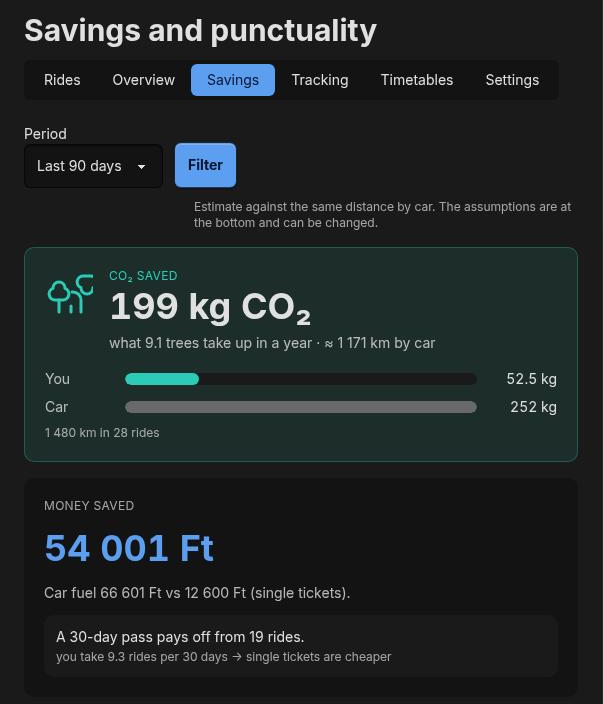
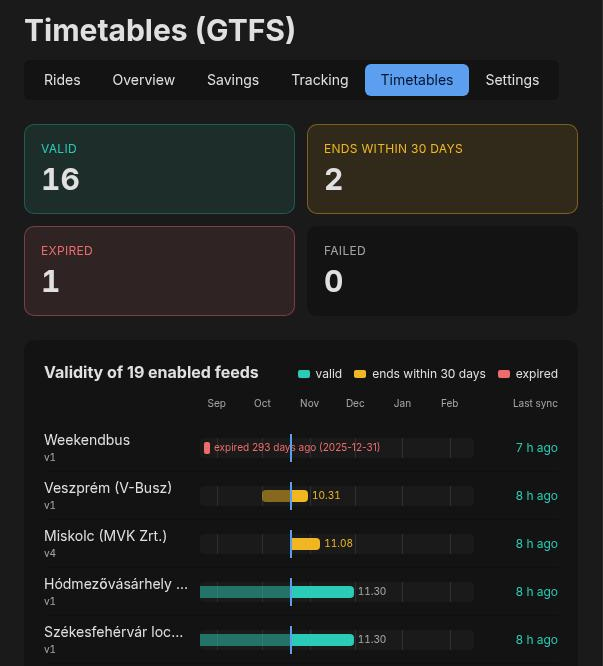
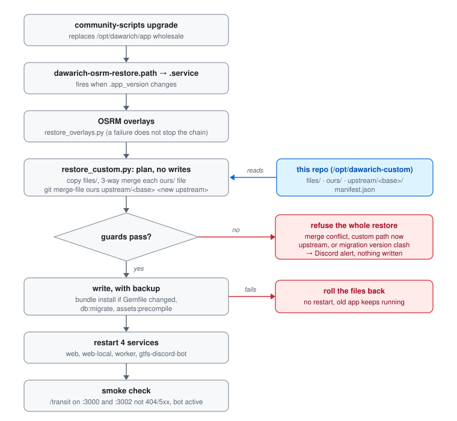

# dawarich-custom

Custom code on top of upstream [Dawarich](https://github.com/Freika/dawarich) 1.16.0.
It matches recorded location history against Hungarian public-transport timetables (GTFS), and
`restore_custom.py` puts it back after every community-script upgrade.


## What it adds

<table>
<tr>
<td width="50%" valign="top"><br>
<b>Rides</b> (<code>/transit</code>): every matched ride with line, stops, on-time state and the uncertain ones to review. Rides are approved from Discord too (<code>dawarich-gtfs-discord-bot</code>).</td>
<td width="50%" valign="top"><br>
<b>Overview</b> (<code>/transit/stats</code>): totals, rides per week, recurring commutes, breakdown by vehicle and operator.</td>
</tr>
<tr>
<td valign="top"><br>
<b>Savings</b> (<code>/transit/savings</code>): CO₂ and money against the same distance by car, plus punctuality.</td>
<td valign="top"><br>
<b>Timetables</b> (<code>/transit/feeds</code>, admins): validity and sync of the 19 enabled feeds, the <code>gtfs</code> job queue, history matching per user.</td>
</tr>
</table>

Also: **Tracking** (coverage and devices), **Settings** (opt-in, feeds, minimum confidence, rematch
the whole history), transit layers on `/map/v2`, and `track_pick`, a daily Discord pick of which
user's track to copy onto the target account.

## How it survives upgrades



A community-script upgrade replaces `/opt/dawarich/app` wholesale. The restore merges our edits into the new
upstream files instead of overwriting them, and stops on anything it cannot merge cleanly.
State: `/var/lib/dawarich-custom/` (`state.json`, backups, `conflicts/<version>/`).

## Layout

| Path | What |
|---|---|
| `files/<rel>` | custom-only files, copied verbatim into the app |
| `ours/<rel>` | our version of a modified upstream file |
| `upstream/<base_version>/<rel>` | the pristine upstream file `ours/` was made from (merge base) |
| `patches/<rel>.patch` | `upstream` → `ours` diff, for reading only (generated) |
| `manifest.json` | `base_version`, `custom_files`, `patched_files` |
| `systemd/` | drop-in that chains the restore after the OSRM overlay restore |

Not stored: `tailwind.css` and `sprockets-manifest.json` (rebuilt by `assets:precompile`) and secrets
(`/opt/dawarich/.env`, `/opt/dawarich/gtfs.env`).

## Commands 

```bash
python3 /opt/dawarich-custom/restore_custom.py --dry-run   # plan only
python3 /opt/dawarich-custom/restore_custom.py             # restore now
python3 /opt/dawarich-custom/restore_custom.py capture     # live app -> repo after editing on the box
python3 /opt/dawarich-custom/restore_custom.py rebase      # after a clean restore on a new upstream version
```

After `capture` or `rebase`: `git diff`, commit, push to OneDev.
New custom file: add its path to `manifest.json` (`custom_files`), then `capture`.

## Migrations

A custom migration version must never equal an upstream one: `db:migrate` silently skips the second.
`create_gtfs_tables` is `20261010115959` because upstream 1.16.0 ships `20261010120000`. On a collision
the restore stops. Fix: rename ours to a free version, insert the new version into `schema_migrations`,
and delete the upstream version's row so upstream's migration runs.

<sub>Screenshots: 2026-10-20, dark theme, own account only.</sub>
